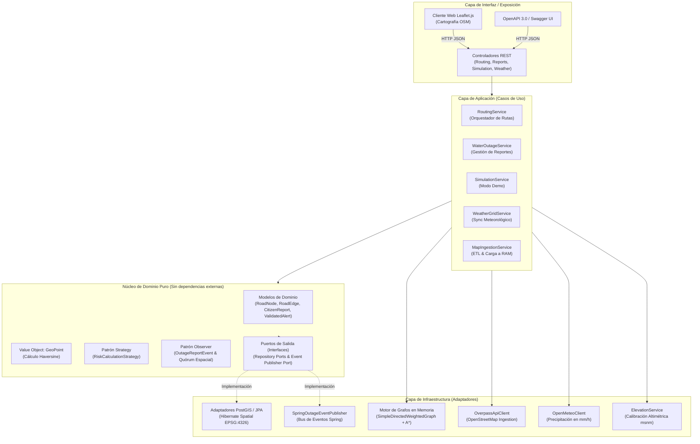
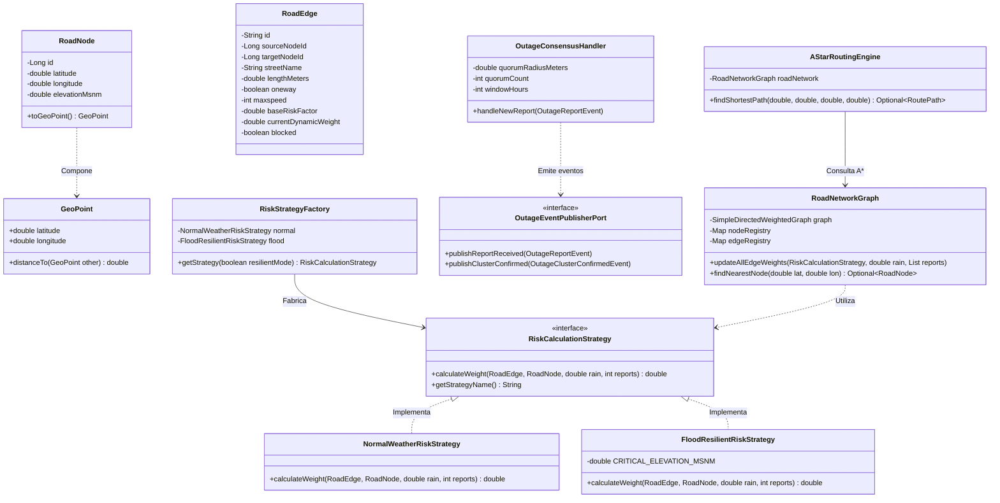
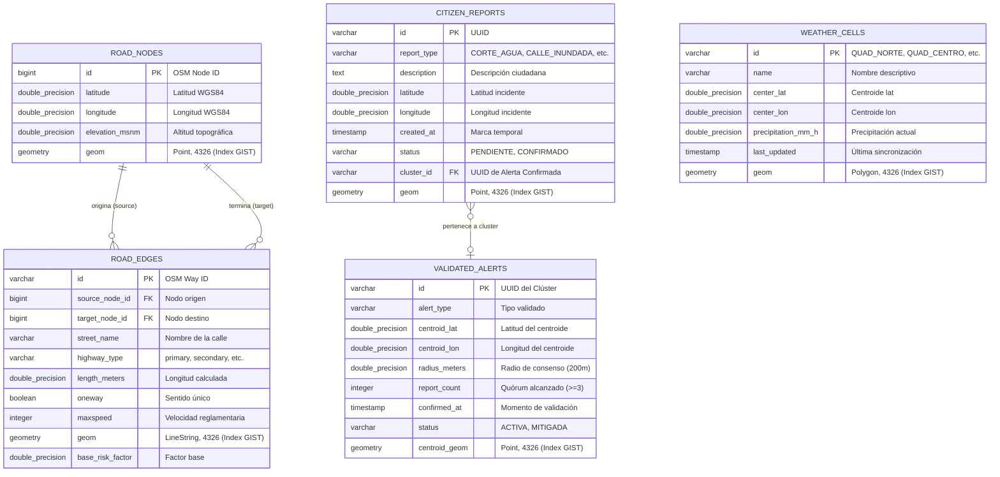

# AquaRuta VSA — Documentación Técnica de Arquitectura e Ingeniería

**Sistema Geoespacial y de Grafos Resiliente a Inundaciones y Crisis Hídrica**  
*Mancha Urbana Céntrica de Villahermosa, Tabasco, México*  
*Proyecto Universitario de Alto Impacto Social — Problema de Atención Nacional #10 ("Crisis del agua")*

---

## 1. Delimitación y Alcance Geográfico

### 1.1 Polígono Operativo
El sistema opera de forma estricta sobre la mancha urbana céntrica de **Villahermosa, Tabasco**, una de las urbes fluviales con mayor vulnerabilidad hidrometeorológica de México por encontrarse asentada en la llanura de inundación de los ríos más caudalosos del país.

* **Límite Norte:** Río Carrizal y zona de Tabasco 2000.
* **Límite Este:** Río Grijalva y margen oriental del Sector Gaviotas (Norte y Sur).
* **Límite Sur y Oeste:** Anillo periférico conformado por el Circuito Interior Carlos Pellicer Cámara y colonias Tamulté de las Barrancas y Atasta de Serra.
* **Bounding Box Geoespacial (WGS84 EPSG:4326):**
  * Latitud mínima: `17.9650` | Longitud mínima: `-92.9650`
  * Latitud máxima: `18.0150` | Longitud máxima: `-92.9050`

```
                [Río Carrizal / Tabasco 2000] (Norte: 18.0150)
                             ▲
                             │
 [Circuito Pellicer Oeste] ◄──┼──► [Río Grijalva / Gaviotas] (Este: -92.9050)
 (-92.9650)                  │
                             ▼
              [Circuito Pellicer Sur / Tamulté] (Sur: 17.9650)
```

### 1.2 Fuentes de Datos Abiertas y Gobernanza
1. **Red Vial:** OpenStreetMap (OSM) consultado mediante Overpass API, procesando jerarquías viales (`trunk`, `primary`, `secondary`, `tertiary`, `residential`).
2. **Modelo Altimétrico:** Open-Elevation API con modelo híbrido determinista calibrado a la topografía local de Villahermosa (3.5 m.s.n.m. en Gaviotas y márgenes fluviales hasta 14.5 m.s.n.m. en lomas de Tabasco 2000).
3. **Meteorología Pluvial:** Open-Meteo API (gratuita, sin API key) para la recolección en tiempo real de precipitación horaria ($\text{mm/h}$) mediante cuadrantes espaciales.
4. **Exclusiones Explícitas:** No se utilizan APIs privativas ni de pago (como Google Maps Platform). Las zonas rurales externas al Circuito Interior quedan fuera del alcance del enrutamiento primario.

---

## 2. Arquitectura de Software Hexagonal (Puertos y Adaptadores)

El sistema implementa estrictamente **Arquitectura Hexagonal (Limpia)**, desacoplando por completo el núcleo algorítmico y matemático (Dominio) de los mecanismos de persistencia (PostGIS), comunicación (REST) y librerías externas.



---

## 3. Diagrama de Clases UML y Patrones de Diseño (SOLID)

La arquitectura aplica principios **SOLID**:
* **S (Single Responsibility):** Cada estrategia, controlador y adaptador atiende un único motivo de cambio.
* **O (Open/Closed):** Nuevas heurísticas o penalizaciones climáticas se incorporan agregando implementaciones de `RiskCalculationStrategy` sin alterar `AStarRoutingEngine`.
* **L (Liskov Substitution):** Cualquier `RiskCalculationStrategy` es perfectamente sustituible en tiempo de ejecución.
* **I (Interface Segregation):** Puertos de repositorio específicos (`RoadNodeRepositoryPort`, `CitizenReportRepositoryPort`, etc.).
* **D (Dependency Inversion):** Los casos de uso dependen exclusivamente de interfaces de dominio, no de JPA ni de bases de datos.



---

## 4. Modelo Entidad-Relación Geoespacial (PostGIS)

La base de datos PostgreSQL 16 con PostGIS almacena geometrías en proyección WGS84 (`EPSG:4326`) indexadas mediante árboles `GIST` para búsquedas espaciales en tiempo logarítmico $\mathcal{O}(\log N)$.



---

## 5. Fundamento Matemático y Algorítmico

### 5.1 Función de Impedancia Hidráulica Dinámica
El peso $W(e)$ asignado a cada arista $e = (u, v)$ en la red vial dirigida para el algoritmo A* se define como:

$$W(e) = T_{\text{base}}(e) \cdot \Psi_{\text{cota}}(v) \cdot \Phi_{\text{lluvia}}(P, v) \cdot \Omega_{\text{reportes}}(v)$$

Donde:
1. **Tiempo Base Ideal:**
   $$T_{\text{base}}(e) = \frac{\text{longitud}(e)}{\max(5.0, v_{\text{max}}(e))} \cdot \mu_{\text{jerarquía}}(e)$$
   $\mu_{\text{jerarquía}} \in \{0.90 \text{ (trunk/primary)}, 1.00 \text{ (secondary)}, 1.25 \text{ (residential)}\}$.

2. **Penalización por Vulnerabilidad Altimétrica:**
   Si la cota del nodo de llegada $z(v) < 6.5\text{ msnm}$:
   $$\Psi_{\text{cota}}(v) = 1.0 + (6.5 - z(v))^{1.6}$$
   Si $z(v) \ge 6.5\text{ msnm}$, $\Psi_{\text{cota}}(v) = 1.0$.

3. **Interacción Pluvial y Escorrentía:**
   Dada la precipitación $P$ en $\text{mm/h}$:
   $$\Phi_{\text{lluvia}}(P, v) = 1.0 + \left[\left(\frac{P}{20.0}\right)^{1.7} \cdot \Psi_{\text{cota}}(v)\right]$$
   Si $P \ge 50.0\text{ mm/h}$ y $z(v) < 4.5\text{ msnm}$ (ej. márgenes del Malecón o Gaviotas), el tramo se considera intransitable ($W(e) \ge 500,000$).

4. **Penalización por Crowdsourcing:**
   Dado el número $k$ de reportes activos de anegamiento en un radio de 120 metros:
   $$\Omega_{\text{reportes}}(v) = \begin{cases} 1.0 + 4.5 \cdot k & \text{si } k < 3 \\ 1,000,000.0 \text{ (Bloqueo absoluto)} & \text{si } k \ge 3 \end{cases}$$

---

### 5.2 Fórmula Geodésica de Haversine
Para determinar la distancia ortodrómica $d$ entre dos coordenadas $(\varphi_1, \lambda_1)$ y $(\varphi_2, \lambda_2)$ sobre la esfera terrestre con radio medio $R = 6,371,000\text{ m}$:

$$\Delta \varphi = \varphi_2 - \varphi_1, \quad \Delta \lambda = \lambda_2 - \lambda_1$$

$$a = \sin^2\left(\frac{\Delta \varphi}{2}\right) + \cos(\varphi_1)\cos(\varphi_2)\sin^2\left(\frac{\Delta \lambda}{2}\right)$$

$$c = 2 \cdot \operatorname{atan2}\left(\sqrt{a}, \sqrt{1 - a}\right)$$

$$d = R \cdot c$$

#### Heurística Admisible para A*
Para que A* garantice encontrar la ruta estrictamente óptima, la función heurística $h(u)$ hacia el destino $t$ debe ser **admisible** ($h(u) \le d^*(u, t)$) y **consistente** ($h(u) \le c(u, w) + h(w)$):

$$h(u) = \frac{\operatorname{Haversine}(u, t)}{v_{\text{teórica\_max}}} \quad \text{donde } v_{\text{teórica\_max}} = 22.22\text{ m/s } (80\text{ km/h})$$

Al subestimar consistentemente el tiempo mínimo físico necesario para alcanzar el destino, se asegura la admisibilidad matemática de JGraphT.

---

### 5.3 Algoritmo de Consenso Espacio-Temporal (Clustering de Reportes)
Para cualquier reporte entrante $r_{\text{in}}$ con marca temporal $t_{\text{in}}$ y tipo $\tau$:
1. Se filtra el conjunto de reportes candidatos:
   $$\mathcal{C} = \{r \in \mathcal{R} \mid \operatorname{tipo}(r) = \tau \land (t_{\text{in}} - t_r) \le 2\text{ horas} \land \operatorname{estado}(r) \ne \text{DESCARTADO}\}$$
2. Se evalúa la proximidad métrica:
   $$\mathcal{K} = \{r \in \mathcal{C} \mid \operatorname{Haversine}(r_{\text{in}}, r) \le 200.0\text{ metros}\}$$
3. Si $|\mathcal{K}| \ge 3$:
   * Se genera una alerta validada $\mathcal{A}$ con centroide:
     $$\bar{\varphi} = \frac{1}{|\mathcal{K}|}\sum_{r \in \mathcal{K}} \varphi_r, \quad \bar{\lambda} = \frac{1}{|\mathcal{K}|}\sum_{r \in \mathcal{K}} \lambda_r$$
   * Todos los reportes en $\mathcal{K}$ transicionan su estado a `CONFIRMADO` vinculados al identificador del clúster.
   * Se emite el evento reactivo `OutageClusterConfirmedEvent`.

---

## 6. Referencias y Documentación Detallada de Código

Para consultar la especificación detallada de cada clase, interfaz, método, algoritmo de grafo en memoria, adaptadores de persistencia y módulos del frontend, consulta:
* [docs/CODIGO_FUENTE.md](CODIGO_FUENTE.md): Manual técnico exhaustivo del código fuente.
* [target/site/apidocs/index.html](../target/site/apidocs/index.html): Documentación formal Javadoc HTML.

